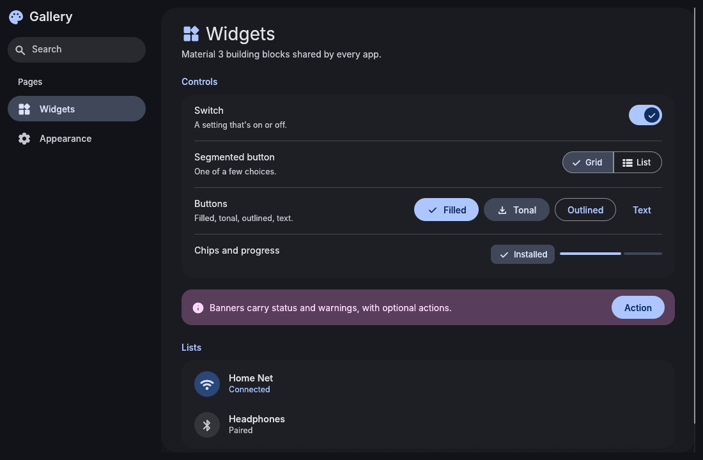

# material-3-ui

The shared look of the Material 3 apps (Settings, Files, Music, Games, Browser, AI, Viewer, Text, Monitor, Screenshots and Calendar), as one Rust crate for [egui](https://github.com/emilk/egui) 0.37.



## What's in it

- **`theme`**:
  - Material You palettes from end4-pC's generated `colors.json` (followed live), a matugen `theme.json`, or a seed color.
  - The egui style built from a palette, with Inter fonts and Material Symbols.
  - `ThemeManager` applies an app's `ThemeSettings` and keeps it current: the palette file is watched and the system light/dark preference is followed.
- **`widgets`**: Material 3 widgets painted with egui. Buttons (filled, tonal, outlined, text, danger), icon buttons, switches, segmented buttons, filter chips, navigation items, progress bars, clickable cards, section headers.
- **`common`**: page scaffolding. Scrolling pages with headers, titled cards, title/description/control rows, banners, modal dialogs, list rows, a pill search field, and `require` for "this needs a tool, install it?" banners.
- **`prefs`**: the Appearance card every app's preferences page shows (color source, light/dark, seed color, filled icons, interface scale).
- **`toasts`**: Material snackbars, generic over the app's action type.
- **`sys`**: background tasks, commands, `~` paths, launching a terminal, and Arch helpers (`installed_packages`, a repo-first-then-AUR `install_command`, distro detection).

## Use it

```toml
[dependencies]
material-3-ui = { git = "https://github.com/bhimio1/material-3-ui", tag = "v0.1.0" }
```

```rust
use material_3_ui::theme::{ThemeManager, ThemeSettings};

// once, in eframe's creation callback
let mut theme = ThemeManager::new(&cc.egui_ctx, &settings);
// every frame
theme.poll(&settings);
// after the user changes appearance settings
theme.apply(&settings);
```

See `examples/gallery.rs` (`cargo run --example gallery`) for every widget in use.

## License

MIT. Fonts: Inter (SIL OFL 1.1, `assets/fonts/LICENSE-Inter.txt`). Icons: Material Symbols via `egui_material_icons`.
