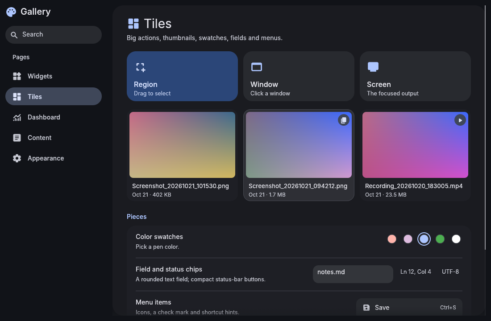
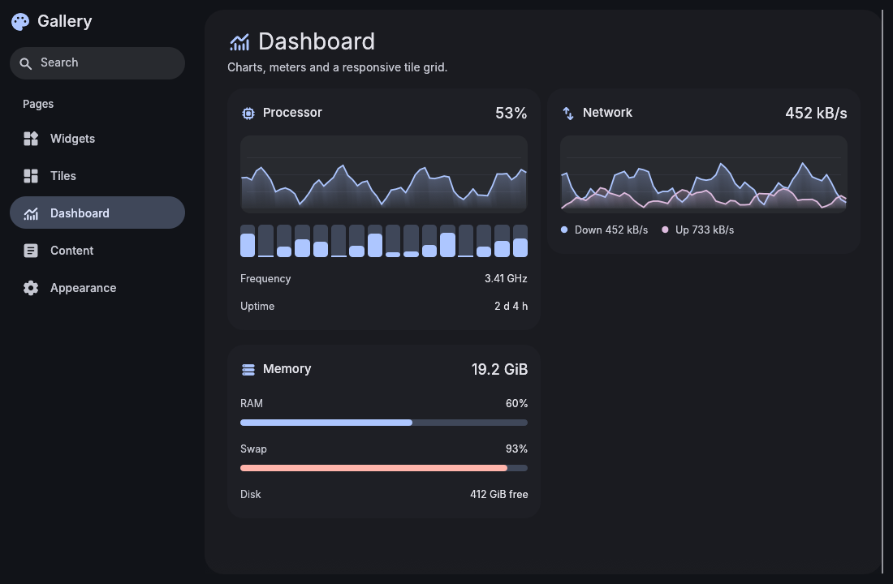
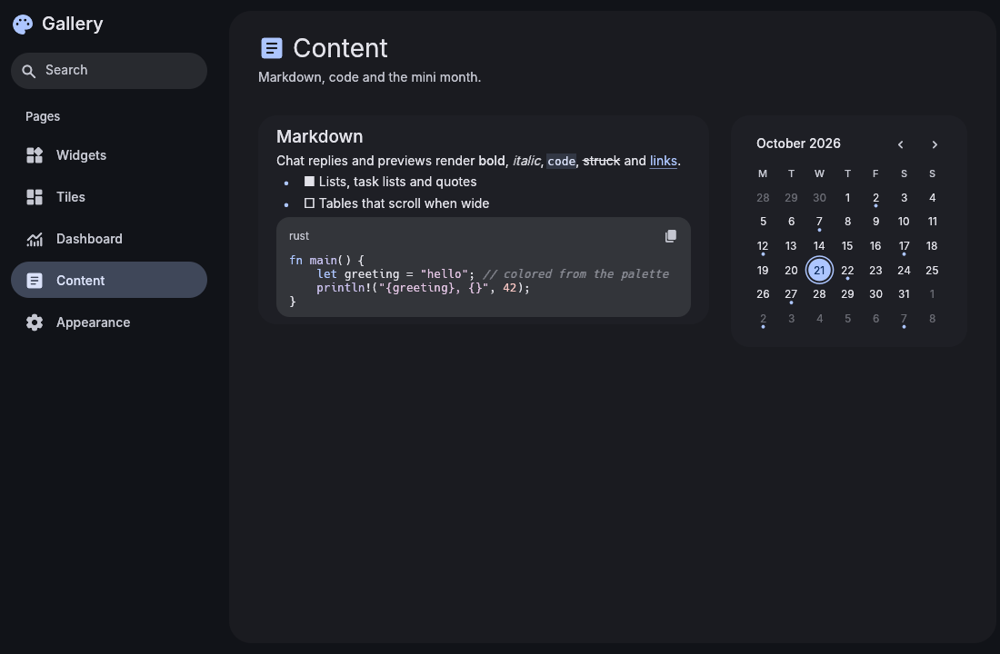

# material-3-ui

The shared look of the Material 3 apps (Settings, Files, Music, Games, Browser, AI, Viewer, Text, Monitor, Screenshots and Calendar), as one Rust crate for [egui](https://github.com/emilk/egui) 0.37.


| Tiles | Dashboard | Content |
| --- | --- | --- |
|  |  |  |

## What's in it

- **`theme`**:
  - Material You palettes from end4-pC's generated `colors.json` (followed live), a matugen `theme.json`, or a seed color.
  - The egui style built from a palette, with Inter fonts and Material Symbols.
  - `ThemeManager` applies an app's `ThemeSettings` and keeps it current: the palette file is watched and the system light/dark preference is followed.
  - `headless_palette` for CLIs without a window, and `SlurpColors` (slurp's `-c -b -s -B` in the desktop's colors). `palette::hex`, `rgba_hex` and `text_on` (black or white on a user color).
- **`widgets`**: Material 3 widgets painted with egui. Buttons (filled, tonal, outlined, text, danger), icon buttons, switches, segmented buttons, filter chips, navigation items, progress bars, clickable cards, section headers, color swatches, big action tiles, thumbnail tiles, a rounded text field, status-bar chips, menu items with check marks and shortcut hints, and `file_icon` by file name.
- **`common`**: page scaffolding. Scrolling pages with headers (and `wide_page` for dashboards), titled cards, title/description/control rows, banners, modal dialogs, list rows, a pill search field, dashboard tiles in a responsive `tile_grid`, and `require` for "this needs a tool, install it?" banners.
- **`charts`**: a live area chart of recent history, usage meters, per-core bars, legends, `nice_max`.
- **`code`**: code colored from the palette. Token kinds (`Tok`), the TextMate scopes every app maps to them, a small built-in tokenizer and the `LayoutJob` builder.
- **`format`**: sizes (`bytes`, `file_size`), transfer rates, durations, MHz and percentages for labels.
- **`keys`**: `take_key`, shortcuts that match their modifiers exactly (Ctrl+S doesn't fire on Ctrl+Shift+S) and drop the character an Alt shortcut types.
- **`fs`**: saving that writes through symlinks and replaces files atomically when that keeps their owner and hard links, `writable`, and `pkexec_write` for root-owned files.
- **`secrets`**: the Secret Service keyring through `secret-tool`, behind a `Secrets` trait (with an in-memory one for tests).
- **`thumbs`**: thumbnails decoded on a background thread and cached as textures by path and modification time.
- **`prefs`**: the Appearance card every app's preferences page shows (color source, light/dark, seed color, filled icons, interface scale).
- **`toasts`**: Material snackbars, generic over the app's action type.
- **`sys`**: background tasks, commands, `~` paths, launching a terminal, the Wayland clipboard (`wl-copy`), and Arch helpers (`installed_packages`, a repo-first-then-AUR `install_command`, distro detection).

Behind cargo features, so an app only builds what it uses (none are on by default):

| Feature | Adds | Pulls in |
| --- | --- | --- |
| `notify` | `notify`: desktop notifications with action buttons; wait for a button or a close | zbus |
| `http` | `http`: agents, `HttpError` statuses, form posts | ureq, url |
| `oauth` | `oauth`: PKCE browser sign-in with a loopback redirect, code exchange, refresh, and `TokenSource` (rotated tokens go to the keyring) | `http`, sha2, base64 |
| `markdown` | `markdown`: the renderer for chat replies and previews, with pluggable code highlighting | pulldown-cmark |
| `calendar` | `calendar`: the mini month and its date math | chrono |
| `backups` | `fs::Backups`: timestamped copies before saving | chrono |
| `image` | `thumbs::load_image`: decode PNG/JPEG/WebP thumbnails | image |
| `testing` | `testing`: a mock HTTP server for apps' tests | |

## Use it

```toml
[dependencies]
material-3-ui = { git = "https://github.com/bhimio1/material-3-ui", rev = "<commit>", features = ["notify"] }

[dev-dependencies]
material-3-ui = { git = "https://github.com/bhimio1/material-3-ui", rev = "<commit>", features = ["testing"] }
```

Pin a commit (or a release tag once there are tags) so every app builds against a known version, and bump it deliberately.

```rust
use material_3_ui::theme::{ThemeManager, ThemeSettings};

// once, in eframe's creation callback
let mut theme = ThemeManager::new(&cc.egui_ctx, &settings);
// every frame
theme.poll(&settings);
// after the user changes appearance settings
theme.apply(&settings);
```

See `examples/gallery.rs` (`cargo run --example gallery --all-features`, optionally with a page: `tiles`, `dashboard`, `content`) for every widget in use.

## License

MIT. Fonts: Inter (SIL OFL 1.1, `assets/fonts/LICENSE-Inter.txt`). Icons: Material Symbols via `egui_material_icons`.
